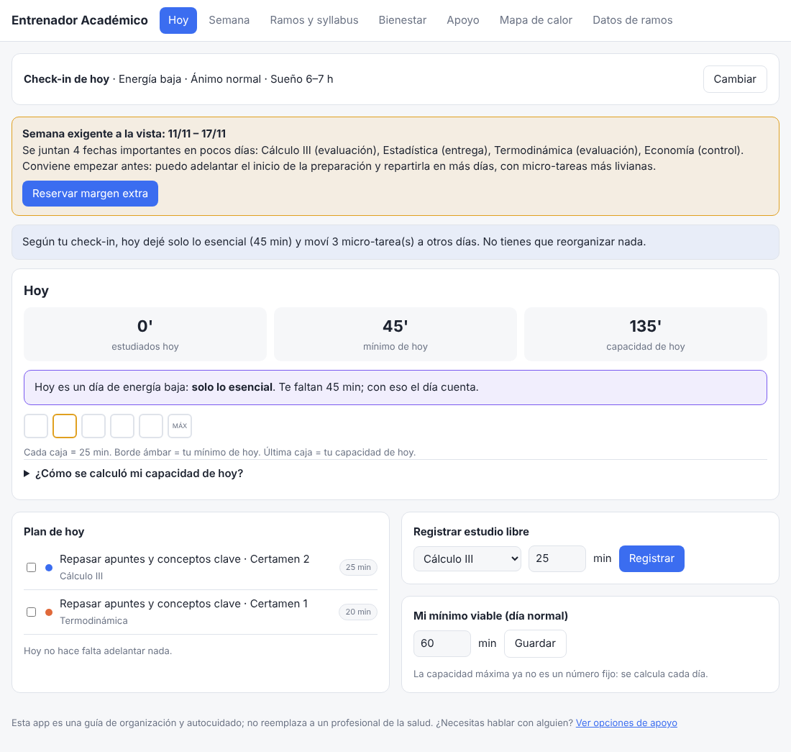

# Entrenador Académico

Una app de organización académica que **se adapta a cómo te sientes**. Tu check-in diario (energía, ánimo y sueño) cambia el plan del día, y la carga académica activa pausas y apoyo cuando se necesitan. Pensada para estudiantes universitarios, con foco en evitar el agotamiento (burnout).



Sin servidor ni cuenta **por defecto**: es HTML, CSS y JavaScript puro. Tus datos se quedan en tu navegador. Amigos es una función opcional que puedes activar con tu propio Supabase.

## La idea

Una agenda más un diario ya existen. Lo distinto aquí es que los dos lados se alimentan entre sí:

```
 check-in diario ──► capacidad realista del día ──► plan adaptado (mínimo viable o plan normal)
        ▲                                                      │
        │                                                      ▼
 alertas y apoyo  ◄── patrones del diario ◄── carga académica (semanas críticas, evaluaciones)
```

## Qué hace

**Ciclo central**
- **Check-in de 20 segundos**: energía, ánimo y sueño en una escala simple.
- **Plan del día adaptativo**: con energía baja muestra solo el mínimo viable y mueve el resto a otros días, sin que reorganices nada.
- **Capacidad realista por día**: no es un número fijo; se calcula con tus horas de clase, tu historial y tu check-in (ver abajo).

**Organización**
- **Syllabus**: subes un PDF (o pegas el texto), la app extrae fechas y evaluaciones y **te pide confirmar** antes de agregarlas, porque la extracción automática se equivoca.
- **Micro-tareas** de 15 a 30 min, con más tiempo y más anticipación para los ramos que más te cuestan.
- **Semanas críticas**: avisa hasta 4 semanas antes cuando se juntan 3 evaluaciones, entregas o controles en 5 días, y propone empezar antes.
- **Reprogramación sin culpa**: lo que no alcanzas se redistribuye solo; no hay lista de "atrasadas" ni rojos.
- **Calendario semanal** con tu horario de clases, y exportación de fechas a `.ics` (Google Calendar, Outlook, Apple).

**Salud mental**
- **Pausas ligadas al calendario**: respiración antes y después de una prueba, la noche previa y dentro de bloques largos de estudio.
- **Respiración guiada** (4-6, en caja, 4-7-8) y **meditaciones breves** con temporizador.
- **Diario con patrones**: cruza tu ánimo y energía con la carga ("tu ánimo promedio baja en semanas con 3 o más evaluaciones"). Son coincidencias en tus datos, no causas ni diagnósticos.
- **Alertas tempranas amables**: varios días seguidos de ánimo bajo, poco sueño, energía baja, 7 días sin descanso o varios días al tope de tu capacidad.
- **Derivación a ayuda real**: líneas de crisis de Chile (*4141, Salud Responde 600 360 7777) y un campo para el servicio de apoyo de tu universidad.

**Datos de ramos (aporte anónimo)**: carga, dificultad, tipo de evaluación y estrategias que sirvieron, como datos agregados; sin texto libre ni nombres de docentes. Por ahora son solo locales.

## Cómo se calcula tu capacidad del día

| Paso | Regla |
|---|---|
| Base | `(840 − minutos de clase − 360) × 0,6`, entre 60 y 270 min (día de 14 h, 6 h de vida personal, 60 % estudiable) |
| Historial | Con 5 o más días de estudio en las últimas 3 semanas, la base se mezcla (70/30) con el percentil 80 de tus días de estudio × 1,15, con tope de +10 % |
| Check-in | Energía × 0,45 / 0,7 / 0,9 / 1 / 1,05 · sueño × 0,8 / 0,9 / 1 · ánimo bajo × 0,9 · piso 0,35 |
| Modo suave | −25 % durante 3 días (opcional, ofrecido cuando hay señales de cansancio) |
| Resultado | Redondeado a 15 min, mínimo 30 |

Con energía baja (nivel 1 o 2, o factor menor a 0,65) el plan de hoy se limita al **mínimo viable** (por defecto 60 min × el factor del día). La app muestra este desglose en "¿Cómo se calculó mi capacidad de hoy?".

> Estos valores son una primera estimación razonable, **no validada**. El siguiente paso natural es calibrarla con uso real.

## Probarla

1. Abre `index.html` en tu navegador. Todo funciona, salvo instalarla y usarla sin conexión.
2. Para la versión completa, sírvela desde `localhost`:
   ```bash
   python3 -m http.server 8000
   # abre http://localhost:8000
   ```
   Así se puede **instalar** (PWA), usar **sin conexión** y activar el **cifrado con contraseña**.
3. En **Ajustes → Datos de ejemplo** hay un botón **Cargar datos de ejemplo** para ver todo en acción.

Al abrir la app aparece **Inicio**, con acceso a Planificación, Académico, Bienestar, Social y Ajustes. Cada sección tiene subpestañas y la ruta se guarda en la URL (`#/academico/notas`), así que recargar o usar Atrás vuelve al mismo lugar. El modo claro es el predeterminado; si cambias a oscuro, tu elección se conserva.

## Publicarla en GitHub Pages

1. Crea un repositorio y sube todos los archivos de esta carpeta (`index.html` debe quedar en la raíz).
2. En el repositorio: **Settings → Pages → Build and deployment → Deploy from a branch**, rama `main`, carpeta `/ (root)`.
3. En uno o dos minutos tendrás un enlace `https://TU_USUARIO.github.io/NOMBRE_DEL_REPO/`.

## Privacidad y datos

Los datos de ánimo, sueño y energía son **datos sensibles**, y se tratan así:

- Por defecto todo se guarda **solo en tu navegador** (almacenamiento local). La app no hace peticiones externas: el lector de PDF viene incluido.
- **Amigos es opcional** y usa tu propio proyecto de Supabase. Si inicias sesión, al servidor van **solo**: tu nombre visible, tu código de amigo, tus relaciones de amistad, las fechas de los ramos que marques explícitamente como compartidos y tus sesiones de estudio.
- Sin Supabase configurado puedes probar **Amigos → Probar con datos de ejemplo**: todo vive en memoria, no se hace ninguna petición de red y nada de ese ejemplo entra en tu respaldo o en el cifrado. Solo una fecha importada desde un amigo se agrega a tus fechas reales.
- El check-in, la energía, el ánimo, el sueño, el diario, las notas personales y las calificaciones **nunca se envían al servidor**, incluso si usas Amigos. No existe tabla para ellos allá.
- Puedes eliminar tu cuenta y los datos del servidor desde **Amigos → Eliminar mi cuenta y mis datos del servidor**. Eso no toca tus datos locales.
- El check-in y el diario piden **consentimiento explícito**. Si no lo das, la app funciona igual como organizador. Puedes revocarlo y borrar tus registros cuando quieras desde **Ajustes → Privacidad**.
- **Cifrado opcional con contraseña** (AES-256-GCM, clave derivada con PBKDF2 de 250 000 iteraciones). Si olvidas la contraseña no hay forma de recuperar los datos: descarga un respaldo antes.
- **Respaldo y restauración** en JSON (cifrado si activaste el cifrado). La restauración valida el archivo y copia solo campos conocidos. La sesión de Supabase **no** se incluye en el respaldo.
- Sin rachas, puntos ni comparaciones de minutos: no se gamifica el bienestar.

La **Ley 21.719** de protección de datos personales de Chile (vigente desde el 1 de diciembre de 2026) aplica a lo que se guarda en el servidor si activas Amigos. Esto no es asesoría legal. La configuración está en `docs/SUPABASE.md`.

## Aviso importante

Esta app es una guía de organización y autocuidado. **No es un dispositivo médico, no diagnostica ni reemplaza a un profesional de la salud.** Los umbrales de las alertas son heurísticos y no están validados clínicamente. Si estás pasando un mal momento, habla con alguien de confianza o con el servicio de apoyo de tu universidad. En Chile, la Línea de Prevención del Suicidio es el **\*4141** y Salud Responde el **600 360 7777**.

## Estructura

```
index.html            página principal
css/styles.css        estilos (modo claro y oscuro)
js/util.js            fechas y utilidades
js/crypto.js          cifrado opcional con contraseña
js/state.js           estado y persistencia local
js/capacity.js        capacidad realista del día
js/planner.js         micro-tareas y semanas críticas
js/wellbeing.js       check-in, alertas, pausas, respiración, patrones
js/syllabus.js        lectura de syllabus (PDF/texto)
js/actions.js         acciones, respaldo, .ics, datos de ejemplo
js/views.js           vistas de cada sección
js/app.js             navegación por hash, render y arranque
js/config.js          URL y anon key de Supabase (vacías por defecto)
js/social-mock.js     backend en memoria para el modo demo de Amigos
js/social.js          Amigos: REST directo o capa demo, OTP, amistades, sesiones y fechas (opcional)
supabase/schema.sql   tablas, RLS, helpers y RPCs (lo ejecutas tú en el SQL Editor)
sw.js, manifest.webmanifest, icons/   app instalable y sin conexión
vendor/               pdf.js (Apache 2.0)
tests/                pruebas automáticas en un navegador real
docs/SUPABASE.md      guía para configurar Amigos
docs/screenshots/     capturas del README
```

## Pruebas

Las pruebas abren la app en Chromium y recorren los flujos reales: navegación por secciones y URL, modo claro predeterminado, capacidad y plan, modo de energía baja, semanas críticas, reprogramación, alertas, consentimiento, lectura de un PDF, respaldo y restauración (incluido un archivo malicioso), `.ics`, funcionamiento sin conexión, cifrado, Amigos (con Supabase simulado mediante `page.route()`, incluida una comprobación de que nunca se envían datos de bienestar) y el modo demo sin red.

```bash
npm install
npx playwright install chromium
npm test
```

## Límites actuales y próximos pasos

- La lectura del syllabus usa reglas, no IA: falla con tablas complejas o PDFs escaneados. Por eso siempre pide confirmar. El paso siguiente es usar un modelo de lenguaje desde un backend.
- La capacidad y los umbrales de alerta necesitan calibrarse con uso real; el planificador podría aprender cuánto tardas de verdad en cada micro-tarea.
- Los datos de ramos son solo locales. Compartirlos entre estudiantes requiere un backend y reglas de anonimato (mínimo de aportes, sin texto libre).
- Los textos de las alertas conviene revisarlos con un profesional de salud mental o con el apoyo estudiantil de tu universidad.
- Importar el horario desde un archivo `.ics`.

## Licencia

MIT (ver `LICENSE`; recuerda poner tu nombre en la línea de copyright). Incluye [pdf.js](https://github.com/mozilla/pdf.js) bajo licencia Apache 2.0.
